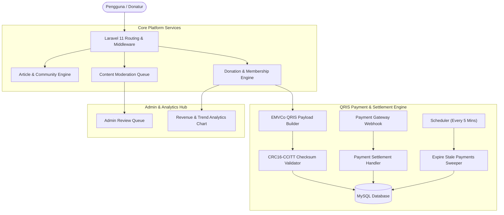

# 🌿 Greentify — Environmental Community & Sustainable Ecosystem Platform

[](https://github.com/luminariadev/greentify/actions/workflows/ci.yml)
[](tests/)
[](LICENSE)
[](https://laravel.com/)
[](https://www.php.net/)
[](https://www.mysql.com/)
[](https://tailwindcss.com/)
[](https://www.docker.com/)

**Greentify** adalah platform publikasi digital, komunitas lingkungan hidup, dan ekosistem donasi konservasi alam berbasis **Laravel 11**. Platform ini dirancang dengan standar arsitektur *production-grade*, dilengkapi verifikasi pengujian otomatis (**188 automated test suites passing**), pipeline pembayaran QRIS berstandar EMVCo, moderasi konten multi-role, marketplace produk ramah lingkungan, serta analitik pendapatan *real-time*.

---

## 🌟 Arsitektur Fitur Utama

1. **Environmental Community & Publishing Engine**
   - Publikasi artikel dengan rich-text editor, upload gambar terproteksi, dan kategori dinamis (*Limbah, Konservasi Air, Penghijauan Kota, Perlindungan Hutan*).
   - Threaded komentar dan reply terproteksi dari spam serta serangan XSS.
   - Manajemen profil pengguna, bio, tracking riwayat artikel, dan followers.

2. **QRIS EMVCo Payment & Donation Engine**
   - Generator payload QRIS dinamis yang mengimplementasikan standardisasi EMVCo QR Code.
   - Kalkulasi checksum **CRC16-CCITT** secara mandiri untuk memvalidasi integritas payload QR.
   - Background job rekonsiliasi otomatis (`payment:reconcile`) untuk mendeteksi transaksi expired dan sinkronisasi status pembayaran via webhook.

3. **Content Moderation & Role-Based Access Control (RBAC)**
   - Tingkatan peran: **Admin**, **Moderator**, dan **Member**.
   - Antrean moderasi laporan konten (*Report Review Queue*) dengan proteksi anti-self-reporting dan rate-limiting ketat.
   - Visualisasi analitik pendapatan donasi & langganan membership menggunakan chart trend interaktif.

4. **188 Automated Tests Suite**
   - Pengujian unit dan feature end-to-end mencakup autentikasi, API Sanctum, siklus hidup donasi, webhook settlement, validasi format QRIS, hingga kontrol akses admin.

---

## 🏛️ Arsitektur Alur Sistem



---

## 📁 Struktur Direktori

```text
greentify/
├── .github/
│   └── workflows/
│       └── ci.yml               # Matrix CI pipeline (PHP 8.2, 8.3, 8.4 + MySQL 8.0)
├── app/
│   ├── Console/Commands/        # Background artisan schedulers (payment expiry & reconcile)
│   ├── Http/
│   │   ├── Controllers/         # REST API & Web Controllers
│   │   └── Middleware/          # Role guard, throttle, and security middleware
│   ├── Models/                  # Eloquent models (Article, Donation, Payment, User)
│   └── Services/                # Domain services (QRIS Payload Builder, CRC calculation)
├── config/                      # Konfigurasi aplikasi Laravel
├── database/
│   ├── factories/               # Model factories untuk testing
│   ├── migrations/              # Skema database MySQL
│   └── seeders/                 # Seeder data awal & kategori lingkungan
├── public/                      # DocumentRoot publik & compiled assets
├── resources/
│   ├── views/                   # Template Blade responsive
│   └── js/                      # Script interaksi frontend
├── routes/                      # Definisi rute web, API, dan console
├── tests/
│   ├── Feature/                 # 188 automated feature tests
│   └── Unit/                    # Unit tests (QRIS EMVCo, CRC, User scopes)
├── .dockerignore                # Rule exclude Docker
├── .gitignore                   # Rule exclude Git
├── Dockerfile                   # Apache PHP 8.2 container
├── docker-compose.yml           # Orkestras Apache + MySQL 8.0
├── LICENSE                      # Lisensi MIT
└── README.md                    # Dokumentasi utama proyek
```

---

## 🚀 Panduan Menjalankan

### Opsi 1: Menggunakan Docker Compose (Direkomendasikan)

Prasyarat: Terinstal Docker dan Docker Compose.

```bash
# 1. Clone repository
git clone https://github.com/luminariadev/greentify.git
cd greentify

# 2. Salin environment
cp .env.example .env

# 3. Jalankan container
docker compose up -d --build

# 4. Generate application key & migrasi database di container
docker compose exec app php artisan key:generate
docker compose exec app php artisan migrate --seed

# 5. Akses platform di browser:
# http://localhost:8000
```

---

### Opsi 2: Menjalankan Menggunakan Server Lokal (PHP CLI & Composer)

```bash
# 1. Install dependensi
composer install
npm install && npm run build

# 2. Setup environment & database
cp .env.example .env
php artisan key:generate
php artisan migrate --seed

# 3. Menjalankan pengujian otomatis (188 tests)
php artisan test

# 4. Menjalankan server lokal
php artisan serve
```

---

## 🧪 Pipeline CI/CD

Repository ini dipantau secara berkala melalui **GitHub Actions** (`.github/workflows/ci.yml`):
- Matrix testing lintas versi PHP: **PHP 8.2**, **PHP 8.3**, dan **PHP 8.4**.
- Pengujian database nyata menggunakan service container MySQL 8.0.
- Eksekusi 188 unit & feature tests tanpa failure toleration.

---

## 📄 Lisensi

Proyek ini didistribusikan di bawah lisensi **MIT**. Silakan tinjau file [`LICENSE`](LICENSE) untuk informasi lebih lanjut.

---

## 👤 Pembuat

**luminariadev**  
- GitHub: [@luminariadev](https://github.com/luminariadev)  
- Email: rizkianuari83@gmail.com
